# GoMotion

**Move smarter. Feel every journey.**

[](https://flutter.dev)
[](#offline-guarantees)
[](#quality-gates)
[](LICENSE)

GoMotion is an offline-first, fictional ride-hailing experience simulator for
Android, iOS, and the web, built with **Flutter** and **Dart**. It recreates the
interaction patterns of a modern mobility superapp for learning, demonstrations,
and experimentation. It is not a real transportation, delivery, or payment
service, and it never contacts a network.

## Live preview

**▶ [https://zann06.github.io/GoMotion/](https://zann06.github.io/GoMotion/)**

The release web build, running in your browser. The first launch shows the
welcome screen; everything after it runs on bundled demo data. Nothing you see
there is real — drivers, restaurants, fares, wallets, orders, and receipts are
all fictional.

## Screenshots

All captures come from the release web build, generated by
[`tool/capture_screenshots.mjs`](tool/capture_screenshots.mjs).

| Cold-start splash | Dashboard | Welcome |
| --- | --- | --- |
| 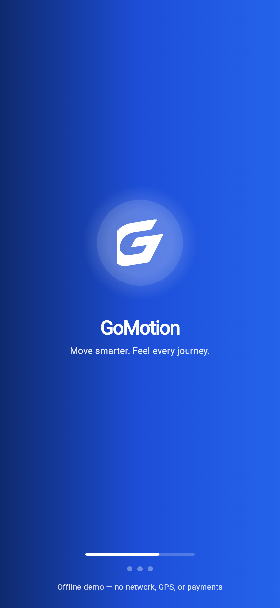 | 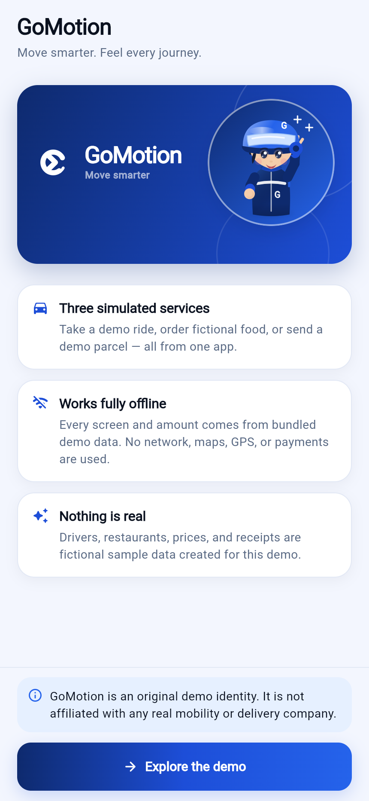 | 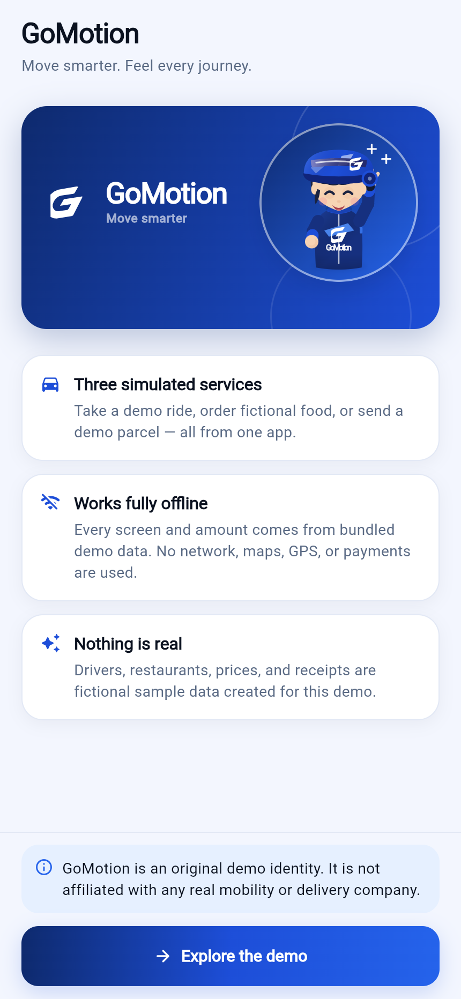 |

| Destination search | GoFood browse | GoFood menu |
| --- | --- | --- |
| 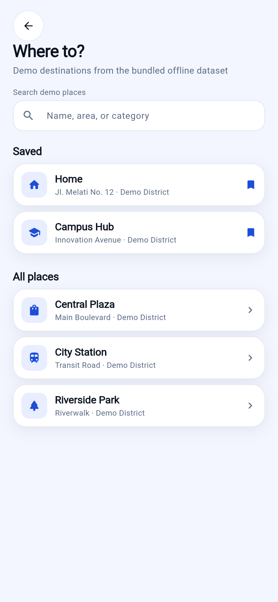 | 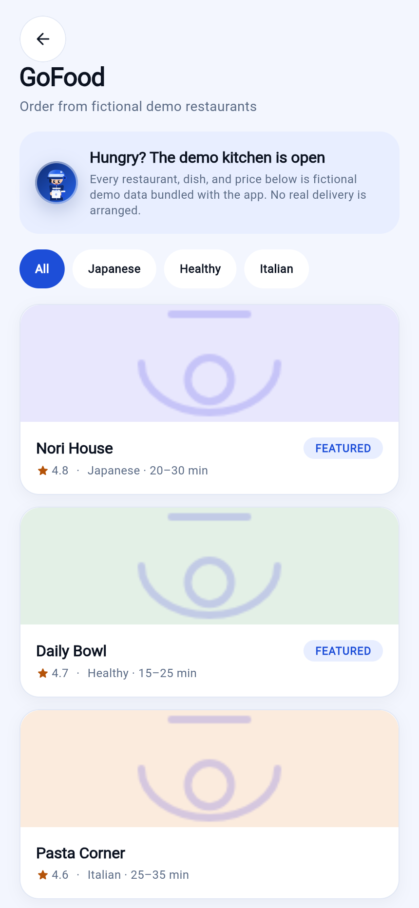 | 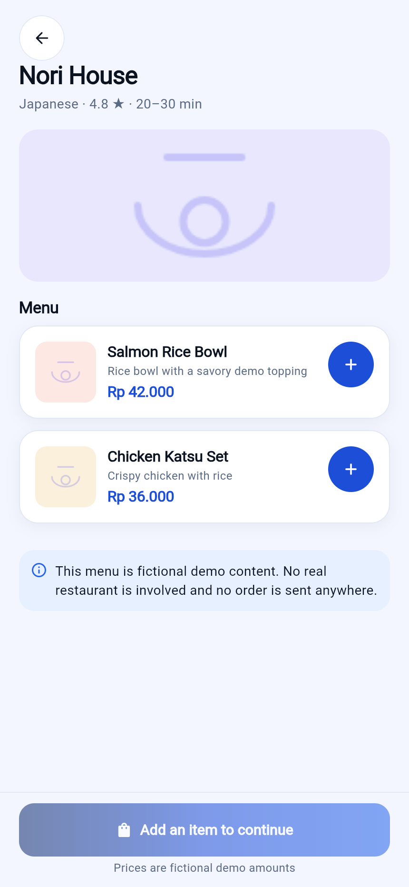 |

| GoSend | Activity | Rewards |
| --- | --- | --- |
| 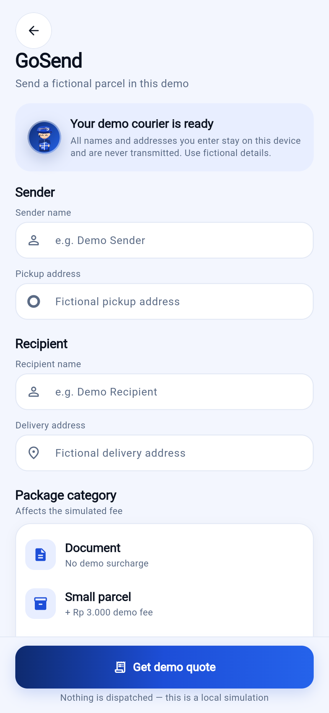 | 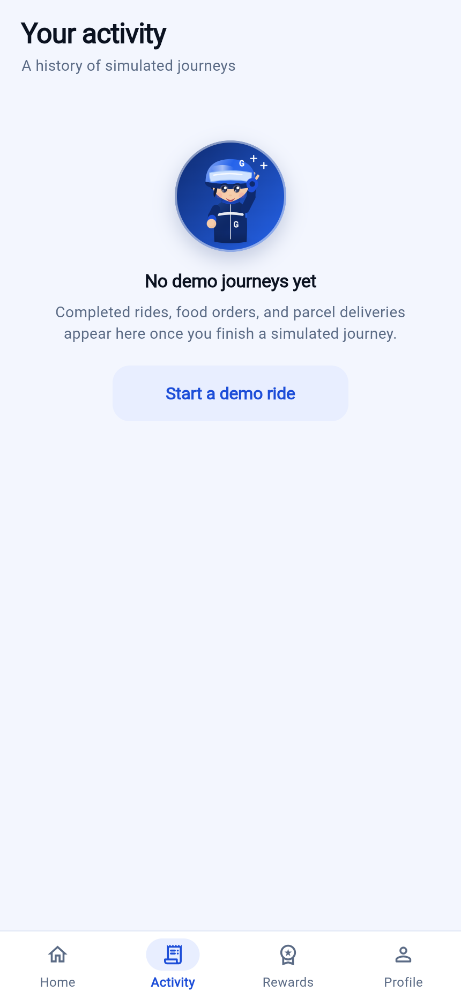 | 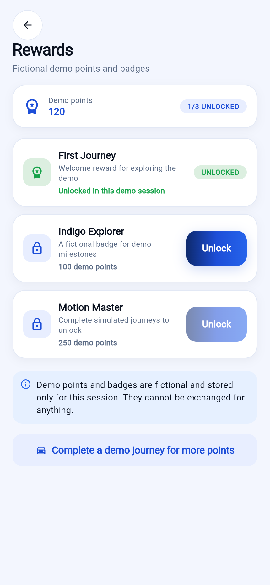 |

| Profile | Settings | About |
| --- | --- | --- |
| 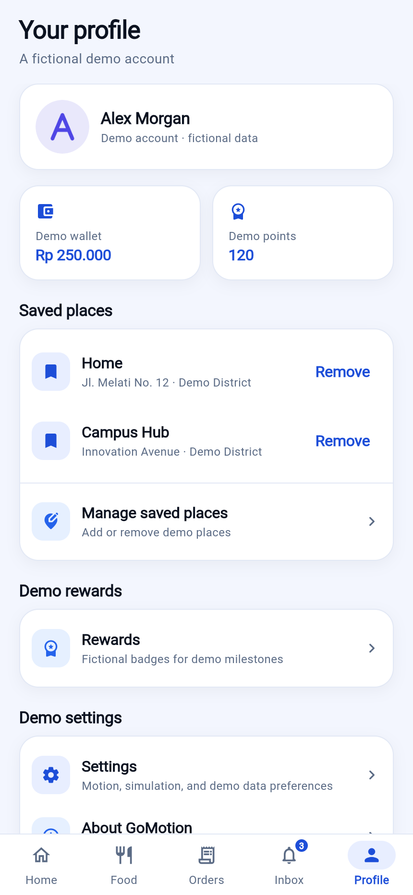 | 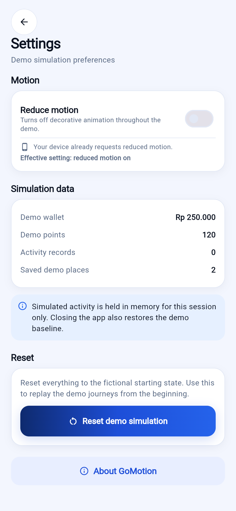 | 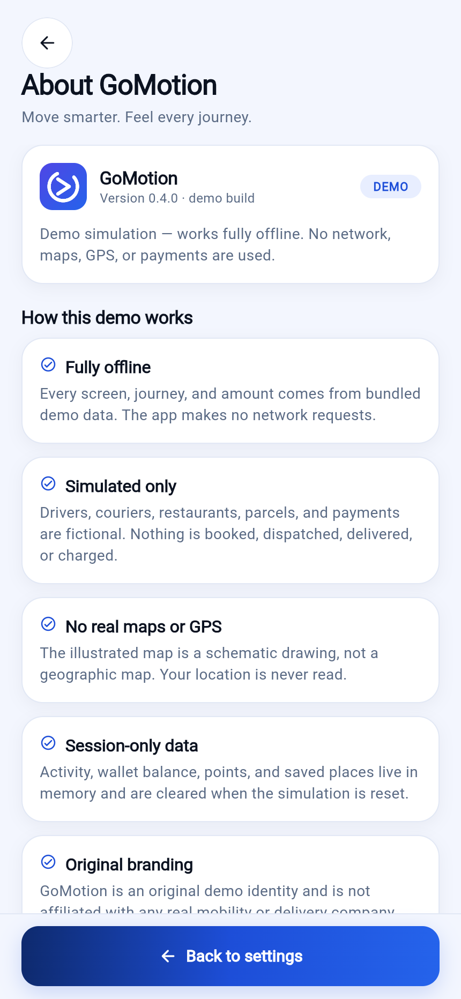 |

## What you can do

| Service | Flow |
| --- | --- |
| **GoRide / GoCar / GoCar Premium** | Search a demo destination, compare simulated fares, apply a demo promo, book, watch a seeded driver match, confirm pickup, track the trip, pay from the fictional wallet or cash, then rate and review the receipt. |
| **GoFood** | Browse fictional restaurants, filter by category, build a cart, check out, track the simulated courier, and view the receipt. |
| **GoSend** | Fill in sender, recipient, and package details, review the quote, follow the courier, and view the delivery receipt. |
| **Activity** | A session ledger of every completed demo journey, with kind filters and a detail view per record. |
| **Profile** | Fictional wallet and points, saved places, rewards, settings, simulation statistics, and a confirmed reset back to the fixture baseline. |
| **Onboarding** | A one-time welcome that explains the offline, fictional nature of the demo. |

Every screen is reachable from the home shell and every control works locally.
Nothing is billed, booked, or sent anywhere.

## Product principles

- **Fully offline** — no backend, API, cloud database, authentication server, remote maps, or remote images.
- **Honest simulation** — all drivers, fares, wallets, orders, ratings, and receipts are fictional demo data.
- **Original identity** — deep blue with an electric-blue and restrained violet accent; no copied operator branding or proprietary assets.
- **Complete local interactions** — no dead-end buttons; every visible action has a defined local outcome.
- **Maintainable code** — feature-first organization, clean boundaries, Riverpod state management, and testable state machines.

## Motion and interaction

Motion is part of the product, not decoration, and it is centralised in
[`lib/core/widgets/app_motion.dart`](lib/core/widgets/app_motion.dart):

- **`AppReveal`** staggers cards into place on the dashboard, GoFood results, vehicle options, and activity history, so a long screen reads as one movement.
- **`AppPressFeedback`** answers a press with a short scale-down (the theme has no ink ripple) and a click cursor on web and desktop.
- **`AppProgressBar`** and **`AppAnimatedCounter`** ease between simulated steps, so trip, order, and parcel progress never jumps.
- Page transitions use one forward fade-slide on Android and desktop; iOS and macOS keep the Cupertino transition so swipe-back still works. Scrolling uses a single physics everywhere.

Two rules are enforced by
[`test/core/widgets/app_motion_test.dart`](test/core/widgets/app_motion_test.dart):

1. **Every effect is a finite one-shot** that releases its ticker, so screens stay smooth and always reach a stable frame.
2. **Reduced motion is honoured structurally.** When it is on, an effect is not played slowly — it is not created at all, and the content renders on its settled frame. A control still taps, and content is never hidden behind an animation that will not run.

The reduced-motion preference is read from the OS setting and can also be
toggled in **Profile → Settings**, where it persists across launches.

## Quick start

1. Install the Flutter stable SDK and verify `flutter doctor`.
2. Clone the repository and enter its directory.
3. Run `flutter pub get`.
4. Run `flutter analyze` and `flutter test`.
5. Launch with `flutter run` on an Android emulator/device. iOS builds require macOS and Xcode.

The app opens on the welcome screen the first time. Use
**Profile → Settings → Reset demo simulation** to replay from the beginning.

## Offline guarantees

- No runtime dependency on HTTP, Firebase, Supabase, mapping APIs, GPS, or payment gateways. The runtime has no HTTP client at all.
- The release Android manifest declares no `INTERNET` or location permission, so the OS blocks network access even in principle.
- All content comes from nine bundled JSON fixtures plus original bundled artwork.
- `shared_preferences` stores only local preferences: onboarding seen and the reduced-motion override. No personal data is collected.

## Quality gates

```bash
dart format .
flutter analyze
flutter test
```

The suite covers fare and promo rules, fixture integrity, simulation generation
tokens and stale-timer rejection, each journey flow end to end, real
tap-through navigation, the motion primitives, and layout checks at 1.0x and
1.3x text scale with reduced motion enabled.

Current status: **173 tests passing, `flutter analyze` clean.**

## Build and release

| Target | Command |
| --- | --- |
| Android debug | `flutter build apk --debug` |
| Android release | `flutter build apk --release` |
| Android App Bundle (Play) | `flutter build appbundle --release` |
| Web release | `flutter build web --release` |
| iOS release (macOS) | `flutter build ipa --release` |

The live preview is built with
`flutter build web --release --base-href /GoMotion/` and published from the
`gh-pages` branch. To regenerate the gallery, serve that build at a `/GoMotion/`
path and run `node tool/capture_screenshots.mjs --url <url>`.

Release signing is read from `android/key.properties`, which is git-ignored.
Copy `android/key.properties.example`, create a keystore, and fill in the values
before building for distribution. When the file is absent the release build
falls back to the debug keystore, so the command still runs for local testing —
never distribute an APK or bundle signed that way.

The iOS build is not verified in this Windows environment; run it on macOS or CI
before shipping.

## Project structure

```
lib/
  app/          # app root, router, theme, providers
  core/         # constants, widgets (incl. app_motion.dart), navigation,
                # feedback, errors
  data/         # fixture loading and local preferences
  domain/       # entities, fare rules, repository contracts
  features/     # home, destination, ride, food, send, activity,
                # profile, rewards, settings, onboarding
  simulation/   # deterministic clock, driver assignment
assets/
  data/         # nine JSON fixtures
  images/       # original bundled artwork
  mascot/       # drop-in slot for the brand character (code-drawn by default)
screenshots/    # README gallery, captured from the release web build
tool/           # development tooling (screenshot capture)
test/           # unit, widget, integration, and accessibility tests
```

## Documentation

This repository publishes the app and this README. The full handover
documentation — product, design system, architecture, data model, simulation
engine, offline strategy, UI/UX guidelines, and the acceptance checklist — is
kept alongside the source in the working copy and is intentionally not published
here.

## Known limitations

- Fictional simulation only: no real drivers, restaurants, parcels, or payments.
- Activity and wallets are held in memory for the session; only simple preferences persist.
- The brand character is drawn in code (`MascotAssets.bundled = false`), so no bitmap pose ships with the repo; dropping PNGs into `assets/mascot/` and flipping that flag swaps in real artwork.
- iOS release build is unverified in this environment (no macOS/Xcode).
- Release output uses the debug keystore until `android/key.properties` is provided.

## License

MIT. See [LICENSE](LICENSE).
