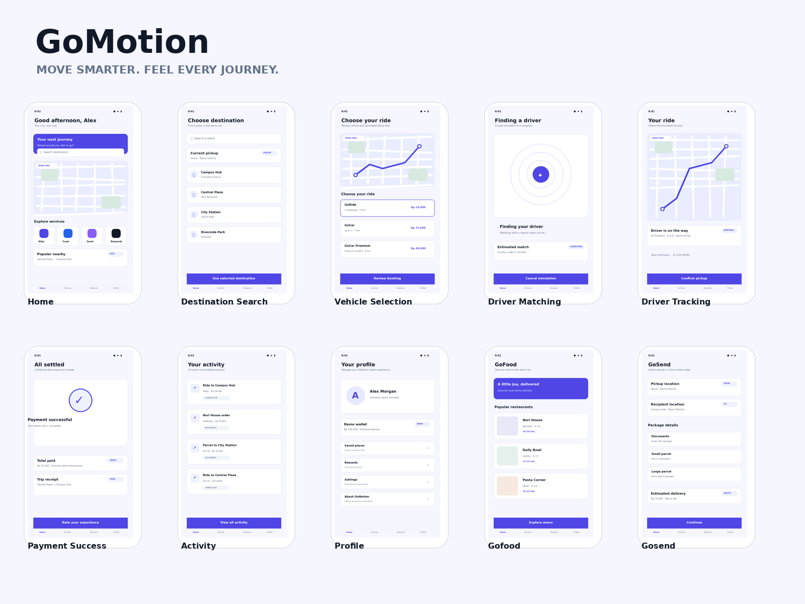

# GoMotion
**Move smarter. Feel every journey.**

GoMotion is an offline-first, fictional ride-hailing experience simulator for Android and iOS, built with Flutter and Dart. It recreates the interaction patterns of a modern mobility superapp for learning, demonstrations, and experimentation. It is not a real transportation, delivery, or payment service, and it never contacts a network.



## Product principles
- Fully offline: no backend, API, cloud database, authentication server, remote maps, or remote images.
- Honest simulation: all drivers, fares, wallets, orders, ratings, and receipts are fictional demo data.
- Original identity: deep blue with an electric-blue and restrained violet accent; no copied operator branding or proprietary assets.
- Complete local interactions: no dead-end buttons; every visible action has a defined local outcome.
- Maintainable code: feature-first organization, clean boundaries, Riverpod state management, and testable state machines.

## What you can do
- **GoRide / GoCar / GoCar Premium** — search a demo destination, compare simulated fares, apply a demo promo, book, watch a seeded driver match, confirm pickup, track the trip, pay from the fictional wallet or cash, then rate and review the receipt.
- **GoFood** — browse fictional restaurants, filter by category, build a cart, check out, track the simulated courier, and view the receipt.
- **GoSend** — fill in sender, recipient, and package details, review the quote, follow the courier, and view the delivery receipt.
- **Activity** — a session ledger of every completed demo journey, with kind filters and a detail view per record.
- **Profile** — fictional wallet and points, saved places, rewards, settings, simulation statistics, and a confirmed reset back to the fixture baseline.
- **Onboarding** — a one-time welcome that explains the offline, fictional nature of the demo.

Every screen is reachable from the home shell, and every control works locally. Nothing is billed, booked, or sent anywhere.

## Quick start
1. Install the Flutter stable SDK and verify `flutter doctor`.
2. Clone the repository and enter its directory.
3. Run `flutter pub get`.
4. Run `flutter analyze` and `flutter test`.
5. Launch with `flutter run` on an Android emulator/device. iOS builds require macOS and Xcode.

The app opens on the welcome screen the first time. Use the in-app reset in
**Profile → Settings → Reset demo simulation** to replay from the beginning.

## Offline guarantees
- No runtime dependency on HTTP, Firebase, Supabase, mapping APIs, GPS, or payment gateways. The runtime has no HTTP client at all.
- The release Android manifest declares no `INTERNET` or location permission, so the OS blocks network access even in principle.
- All content comes from nine bundled JSON fixtures plus original bundled artwork.
- `shared_preferences` stores only local preferences: onboarding seen and the reduced-motion override. No personal data is collected.

## Quality gates
```bash
dart format .
flutter analyze
flutter test
```
The suite covers fare and promo rules, fixture integrity, simulation generation tokens and stale-timer rejection, each journey flow end to end, real tap-through navigation, and layout checks at 1.0x and 1.3x text scale with reduced motion enabled.
Current status: **123 tests passing, `flutter analyze` clean.**

## Build
- Android debug: `flutter build apk --debug`
- Android release: `flutter build apk --release`
- Android App Bundle (Play): `flutter build appbundle --release`
- iOS release (macOS): `flutter build ipa --release`

Release signing is read from `android/key.properties`, which is git-ignored.
Copy `android/key.properties.example`, create a keystore, and fill in the values
before building for distribution. When the file is absent the release build
falls back to the debug keystore, so the command still runs for local testing —
never distribute an APK or bundle signed that way.

The iOS build is not verified in this Windows environment; run it on macOS or CI
before shipping.

## Project structure
```
lib/
  app/          # app root, router, theme, providers
  core/         # constants, widgets, navigation, feedback, errors
  data/         # fixture loading and local preferences
  domain/       # entities, fare rules, repository contracts
  features/     # home, destination, ride, food, send, activity,
                # profile, rewards, settings, onboarding
  simulation/   # deterministic clock, driver assignment
assets/
  data/         # nine JSON fixtures
  images/       # original bundled artwork
docs/           # product, design, architecture, QA specifications
```

## Documentation map
See `docs/` for product, design, architecture, data, simulation, privacy, testing, and roadmap specifications. See `prompts/` for coding-agent task prompts. See `AGENTS.md` for mandatory implementation constraints.

## Known limitations
- Fictional simulation only: no real drivers, restaurants, parcels, or payments.
- Activity and wallets are held in memory for the session; only simple preferences persist.
- iOS release build is unverified in this environment (no macOS/Xcode).
- Release output uses the debug keystore until `android/key.properties` is provided.

## License
MIT. See [LICENSE](LICENSE).